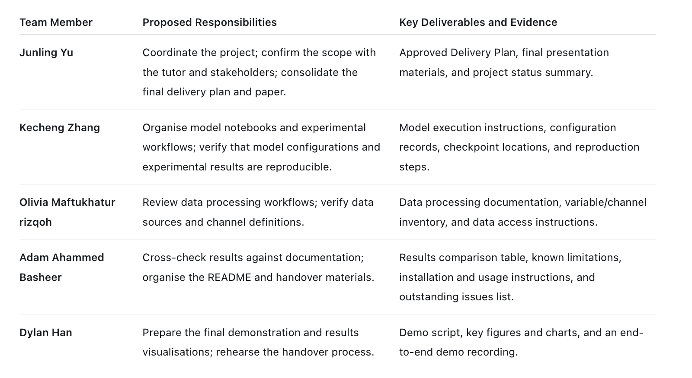

# Week 20 Report 🗂️

---

**Week:** Week 20
**Date:** 2026-10-19
**Attendees:** Kecheng, Junling, Olivia, Adam, Dylan  

---

## Agenda

1. Review the current CRAFT repository and delivery readiness.
2. Allocate Week 11 repository, documentation and project consolidation tasks.
3. Confirm the scope of the Week 12 presentation.

## Discussion

> The team reviewed the current GitHub repository, including the data-processing notebooks, model notebooks, server-side experiments, results, documentation and draft paper. While substantial work has been completed, some materials remain spread across notebooks, local environments and server locations. Several notebooks contain exploratory or duplicated code, and some project documentation no longer reflects the latest implementation.
> The team agreed to use Week 11 to ensure that all relevant work is committed to GitHub, clean up the notebooks and scripts, document the ACCESS-SY data and preprocessing decisions, record incomplete or unsuccessful work, and update the README with the current project status and logical next steps. Week 12 will be reserved for the final presentation, with all five team members participating.

## Decisions

- All relevant project work must be committed and pushed to the GitHub repository during Week 11.
- Each member is responsible for reviewing and committing their own work.
- Notebooks and scripts included in the final repository must be understandable and runnable by another person.
- Temporary cells, unclear file paths, obsolete experiments and unnecessary notebook outputs should be removed or clearly identified.
- ACCESS-SY data sources, variables, directory structure, preprocessing steps and important technical decisions must be documented.
- Incomplete features, unsuccessful approaches, known issues and areas requiring further investigation must be recorded honestly.
- The README must describe the current state of the project and its logical next steps.
- The README, paper, notebooks and results documentation must use consistent descriptions.
- No major new features will be started during Week 11 unless required to resolve a delivery issue.
- Week 12 will be used for the final presentation and assessor questions, with all team members participating.

## Action Items

## Progress Summary

> The project currently includes ACCESS-SY exploration and preprocessing notebooks, model-training notebooks, server-side training and evaluation results, visualisations, setup documentation and a draft paper. The main technical components are available, but the repository requires consolidation before handover. Week 11 work will focus on creating an up-to-date GitHub repository that another person can understand, run and continue developing.

## Completed This Week

- Reviewed the current repository structure and identified the main delivery materials.
- Confirmed that server-side model training and evaluation results are available.
- Identified inconsistencies between the implementation, README, notebooks and draft paper.
- Identified existing documentation for setup, contribution, data processing and model development.
- Agreed on the Week 11 scope and task allocation.

## In Progress

- Reviewing uncommitted work and ensuring that completed work is included in GitHub.
- Cleaning up notebooks and scripts for readability and reproducibility.
- Documenting ACCESS-SY data and the preprocessing workflow.
- Recording preprocessing and modelling decisions.
- Consolidating model results and baseline comparisons.
- Updating the README and handover documentation.
- Recording incomplete work, unsuccessful approaches and further investigation needs.

## Blockers

- Raw and processed ACCESS-SY datasets are not stored in Git and may require local or Gadi access. Model checkpoints and normalisation statistics may remain on the training server. The team must document how these resources can be accessed or reproduced.
- Some notebooks may depend on environment-specific paths or previously generated files. These dependencies must be replaced with configurable paths where practical or clearly documented when they cannot be removed.
- The paper, README and notebooks contain some outdated or inconsistent statements about the implementation and experimental status. These need to be reconciled before delivery.

## Plan for Next Week

- Deliver the final presentation as a complete team.
- Present the project motivation, ACCESS-SY data workflow, model design and current results.
- Demonstrate that the GitHub repository and handover documentation are organised and up to date.
- Explain baseline comparisons, incomplete work, known limitations and future investigation areas.
- Present the logical next steps for continuing the project.
- Respond to tutor and assessor questions as a team.

## Next Meeting

**Date:** 2026-10-26